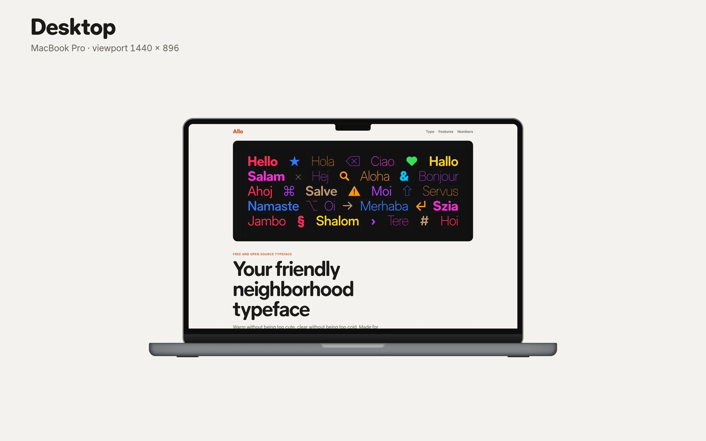
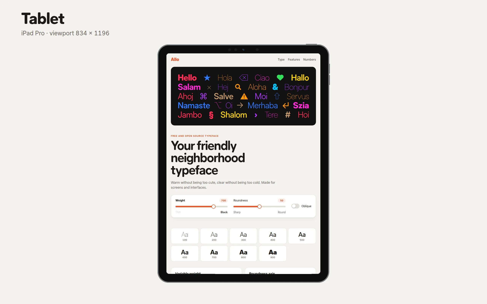
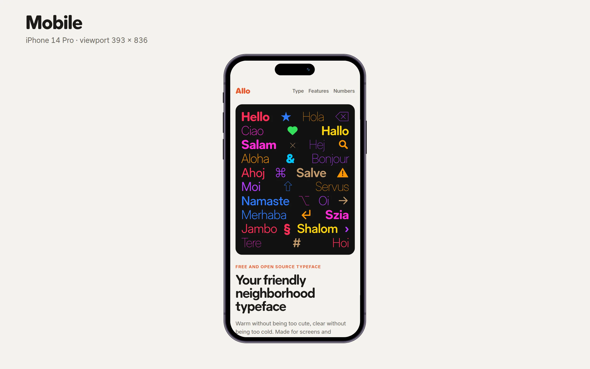
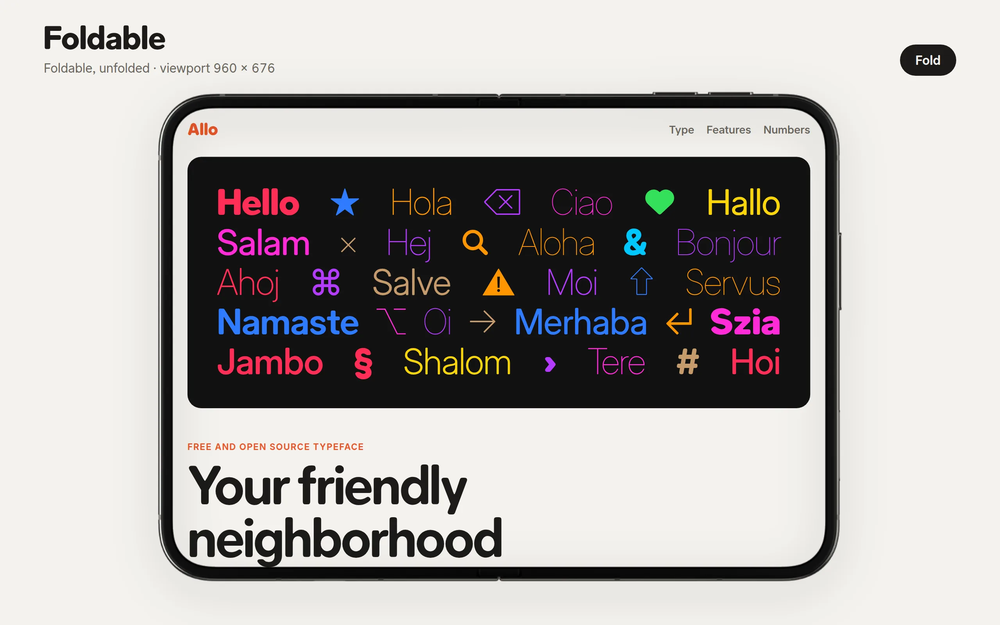
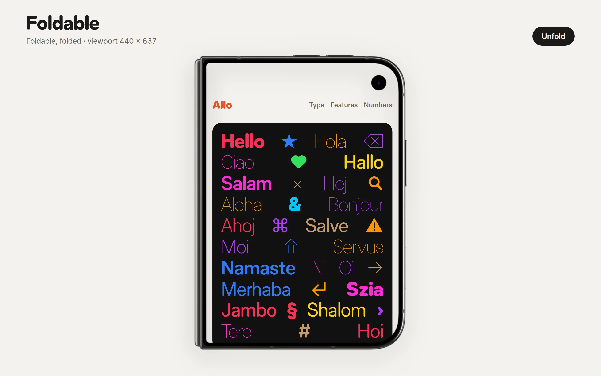

# Allo device test

A small React + Vite app for testing the [Allo](https://github.com/joshpuckett/allo) typeface on real screen sizes.

A demo page set in Allo (an animated greeting wall, weight and roundness sliders, weights, features and tabular figures) is shown inside four device mockups, one at a time:

| Device | Viewport |
|---|---|
| MacBook Pro | 1440 × 896 |
| iPad Pro | 834 × 1196 |
| iPhone 14 Pro | 393 × 836 |
| Foldable, unfolded / folded | 960 × 676 / 440 × 637 |

Each device loads the demo in an iframe at its real viewport size, scaled down to fit, so the demo's responsive layout is genuinely tested. The page always fits one screen.

## Screenshots



| Tablet | Mobile |
|---|---|
|  |  |

| Foldable, unfolded | Foldable, folded |
|---|---|
|  |  |

## Switching devices

- **Keys:** ← → (and Home / End)
- **Gestures:** touch swipe, mouse drag, or two-finger trackpad swipe, also over the device screens
- **Links:** `#desktop`, `#tablet`, `#mobile`, `#foldable`

On the foldable, **Fold / Unfold** switches between its two screens; both stay loaded.

## Run it

```bash
npm install
npm run dev
```

`npm run build` makes a production build in `dist/`.

## Credits

- [Allo](https://github.com/joshpuckett/allo) by Josh Puckett, SIL Open Font License
- MacBook, iPad and iPhone frames from [devices.css](https://github.com/picturepan2/devices.css) (MIT)
